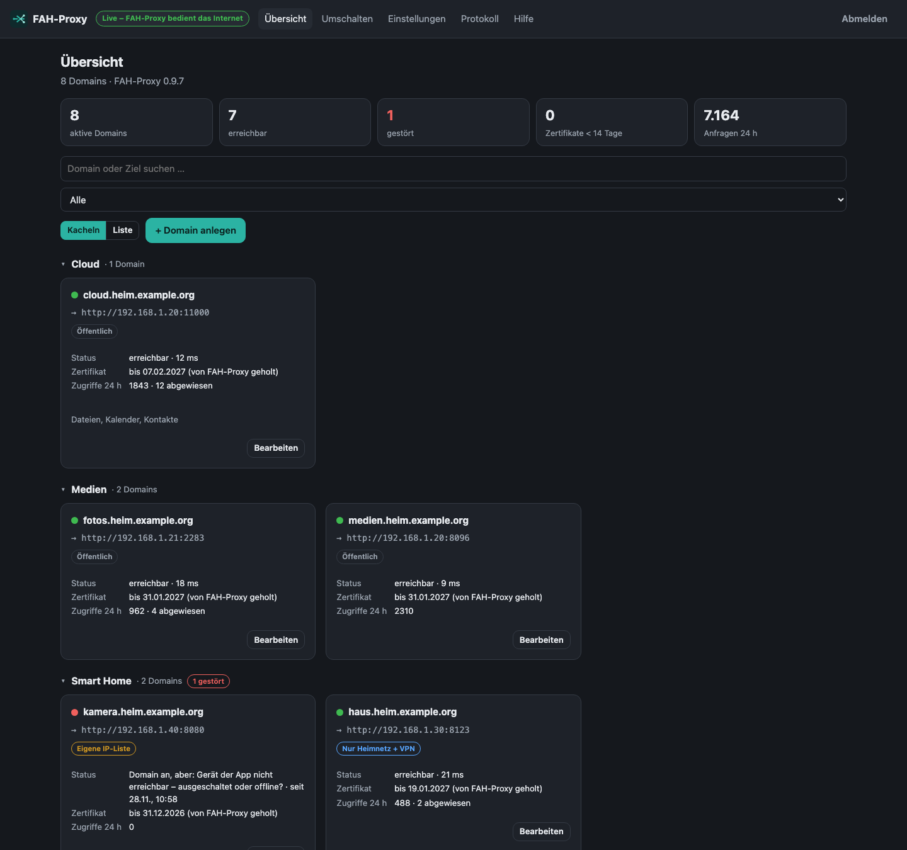
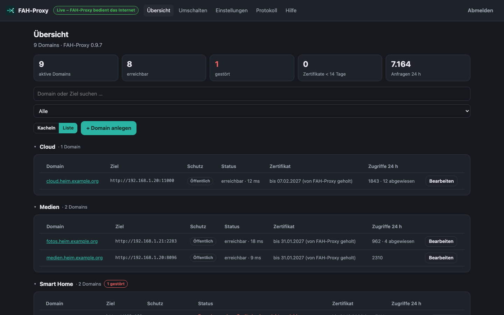
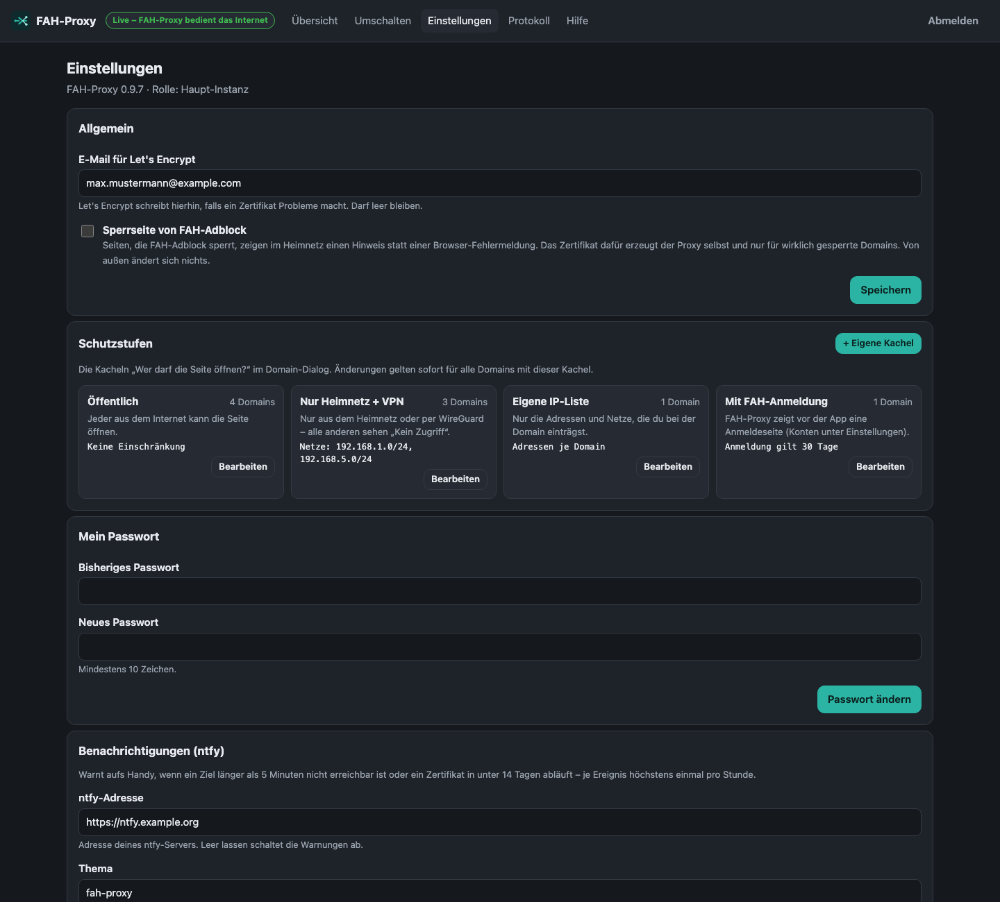
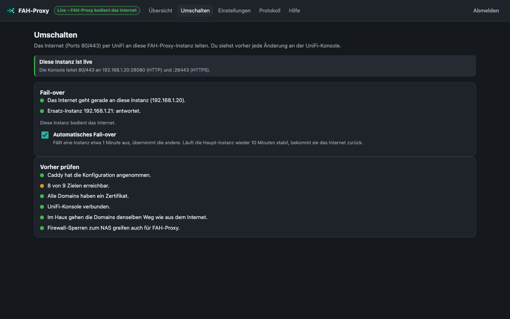
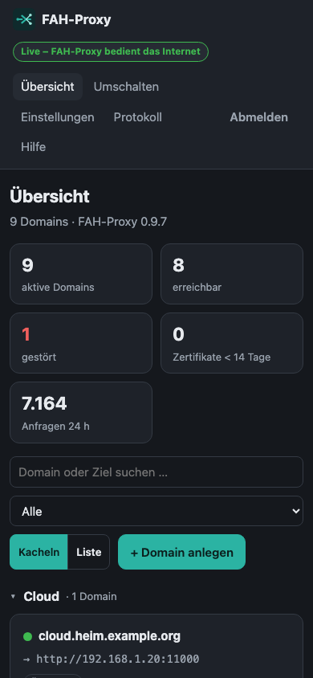

# FAH-Proxy

Reverse-Proxy mit einfacher Oberfläche – Caddy als Motor, Zertifikate automatisch.

- **Domain in einem Schritt:** Adresse + Ziel eintragen, Zertifikat und HTTPS kommen von selbst.
- **Schutz per Klick:** Öffentlich · Nur Heimnetz + VPN · Eigene IP-Liste · Mit FAH-Anmeldung.
- **Status:** je Domain Ziel erreichbar?, Zertifikat gültig bis?, Zugriffe der letzten 24 h.
- **Umschalten per UniFi:** leitet 80/443 an FAH-Proxy (mit Vorschau jeder Änderung, Sicherung, Firewall- und DNS-Abgleich).
- **Zwei Instanzen mit Fail-over:** Haupt + Ersatz gleichen sich ab (immer von der aktiven zur anderen); fällt die aktive
  aus, übernimmt die andere, danach geht das Internet samt Änderungen der Ausfallzeit zurück.
- **Rolle „Dienst“ für andere FAH-Apps:** ein eingeschränktes Konto ohne Zugriff auf die Verwaltung. FAH-Adblock
  legt damit seine Gerätenamen (`dns-<name>.<basis>`) für den Schutz unterwegs selbst an und löscht sie wieder –
  nur in der Gruppe „AdBlock DNS Domains“, fremde Domains bleiben unberührt. Die Zertifikate holt es sich von hier.

## So sieht es aus

*Aufgenommen aus einer Wegwerf-Instanz mit erfundenen Daten: Domains `*.heim.example.org`, Ziele `192.168.1.x`,
Konto `max.mustermann`. Es sind keine echten Adressen oder Daten zu sehen.*

Die **Übersicht** zeigt oben die Kennzahlen und darunter je Rubrik eine Kachel pro Domain mit Ziel, Schutzstufe, Status,
Zertifikat und Zugriffen der letzten 24 h. Eine gestörte App fällt mit rotem Punkt und dem Grund sofort auf.

Die **Liste** zeigt dieselben Domains kompakt als Tabelle, eine Zeile je Domain, zum schnellen Durchsehen vieler Einträge.

Unter **Domain bearbeiten** ändert man Adresse, Ziel und Rubrik und wählt per Kachel, wer die Seite öffnen darf.

In den **Einstellungen** stehen die E-Mail für Let's Encrypt, die Schutzstufen mit der Zahl ihrer Domains, das eigene
Passwort und die ntfy-Warnungen.

Das **Protokoll** listet jede Änderung und jede Störung mit Zeit, Urheber und Einzelheiten, die neuesten zuerst.

**Umschalten** zeigt, ob diese Instanz das Internet bedient, ob die Ersatz-Instanz antwortet und ob Caddy, Ziele,
Zertifikate und die UniFi-Konsole in Ordnung sind.

Am **Handy** ordnet sich die Oberfläche untereinander an, alle Funktionen bleiben erreichbar.

Die Bilder macht `node tools/bildschirmfotos.mjs` neu (nach jeder sichtbaren Änderung). Das Skript startet eine
Wegwerf-Instanz mit erfundenen Daten und bedient die Oberfläche in Chromium headless: anmelden, Domain anlegen,
Liste und Kacheln, Domain bearbeiten. Jede Ansicht prüft es zusätzlich schmal (720 px) und breit (2200 px).
Mit `--nur-probe` läuft es nur als Bedienprobe, mit `--breiten <ordner>` legt es die Schmal- und Breit-Aufnahmen
zum Ansehen ab.

## Installation
`fah-proxy_release.zip` und `manage.sh` in einen leeren Ordner legen, dann `./manage.sh update`.
Danach `https://<Rechner>:28181` öffnen (Zertifikat ist selbstsigniert), Anmeldung **admin / admin**, eigenes Passwort setzen.
Auf FAH-NAS: Apps → „App aus ZIP“.

Ports (in `.env`, belegt → nächster freier): HTTP 28080, HTTPS 28443, Oberfläche 28181.

## Git-Server dahinter
Domain wie `git.example.org` anlegen, Ziel = Git-Server (z. B. `http://<Rechner>:3300`), Schutz **Nur Heimnetz + VPN**.
Dann laufen `git clone` und `git push` über HTTPS mit dem Zertifikat von FAH-Proxy. Benutzer und Zugangsschlüssel prüft
der Git-Server selbst. Den Schutz **Mit FAH-Anmeldung** nicht nehmen: git bekommt ohne Sitzungscookie die Weiterleitung
zur Anmeldeseite und bricht ab. Die Sperre richtet sich nach der echten Absenderadresse (`remote_ip`), ein mitgeschickter
`X-Forwarded-For`-Kopf öffnet nichts.

## Befehle
`./manage.sh update [zip] | up | down | restart | rebuild | logs | status | url | port | admin-reset`

Daten liegen in `daten/` (Domains, Konten, Zertifikate, Protokoll) und `caddy-daten/` (von Caddy geholte Zertifikate);
ein Update fasst sie nie an.
