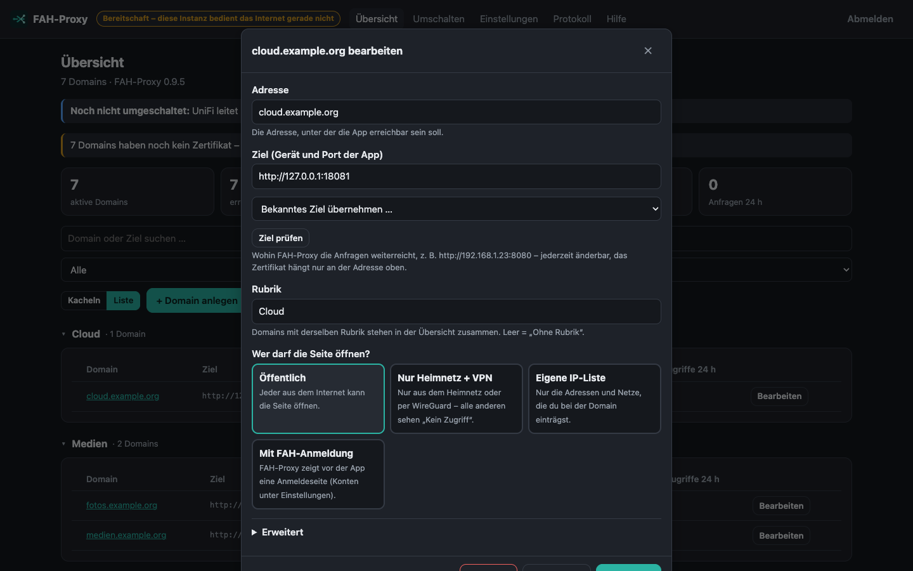
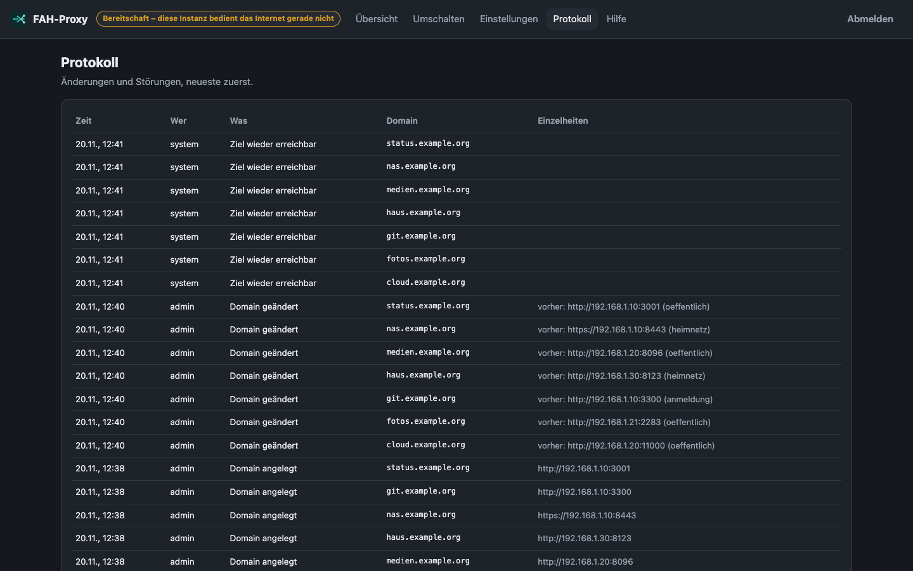

# FAH-Proxy

Reverse-Proxy mit einfacher Oberfläche – Caddy als Motor, Zertifikate automatisch.

- **Domain in einem Schritt:** Adresse + Ziel eintragen, Zertifikat und HTTPS kommen von selbst.
- **Schutz per Klick:** Öffentlich · Nur Heimnetz + VPN · Eigene IP-Liste · Mit FAH-Anmeldung.
- **Status:** je Domain Ziel erreichbar?, Zertifikat gültig bis?, Zugriffe der letzten 24 h.
- **Umschalten per UniFi:** leitet 80/443 an FAH-Proxy (mit Vorschau jeder Änderung, Sicherung, Firewall- und DNS-Abgleich).
- **Zwei Instanzen mit Fail-over:** Haupt + Ersatz gleichen sich ab (immer von der aktiven zur anderen); fällt die aktive
  aus, übernimmt die andere, danach geht das Internet samt Änderungen der Ausfallzeit zurück.

## Screenshots

*Aufgenommen mit erfundenen Beispiel-Domains (`*.example.org`) und Platzhalter-Zielen – keine echten Adressen oder Daten.*

| Liste | Domain bearbeiten |
|---|---|
|  |  |
| **Einstellungen & Schutzstufen** | **Umschalten (Fail-over)** |
|  |  |
| **Protokoll** | **Handy** |
|  |  |

## Installation
`fah-proxy_release.zip` und `manage.sh` in einen leeren Ordner legen, dann `./manage.sh update`.
Danach `https://<Rechner>:28181` öffnen (Zertifikat ist selbstsigniert), Anmeldung **admin / admin**, eigenes Passwort setzen.
Auf FAH-NAS: Apps → „App aus ZIP“.

Ports (in `.env`, belegt → nächster freier): HTTP 28080, HTTPS 28443, Oberfläche 28181.

## Befehle
`./manage.sh update [zip] | up | down | restart | rebuild | logs | status | url | port | admin-reset`

Daten liegen in `daten/` (Domains, Konten, Zertifikate, Protokoll) und `caddy-daten/` (von Caddy geholte Zertifikate);
ein Update fasst sie nie an.
